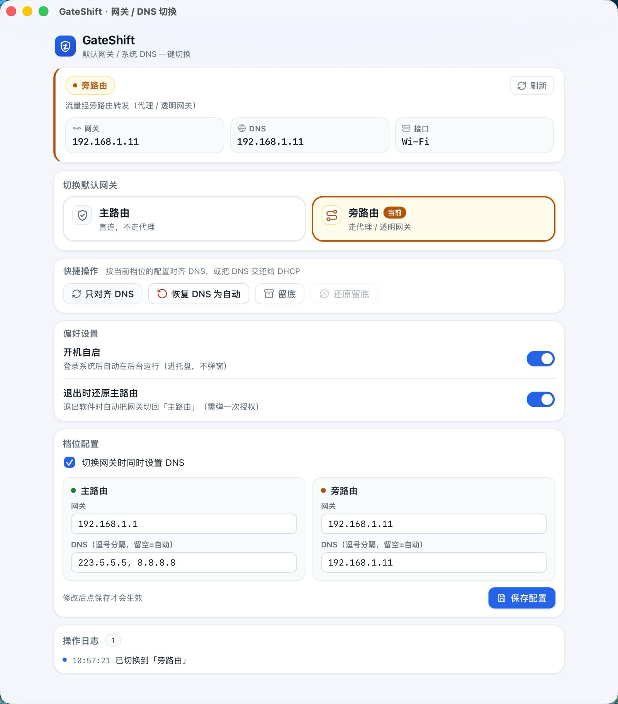

# GateShift

**一键把 macOS / Windows 的默认网关和系统 DNS 切到「旁路由」，用完再一键切回「主路由」。**

家里或办公室同时有「主路由 + 旁路由（软路由）」的人应该都经历过：想走旁路由上网，就得手动打开
「系统设置 → 网络 → 高级 → TCP/IP / DNS」改网关，用完再改回去。改错了全家断网，改漏了 DNS 又不通。

GateShift 就是一个常驻菜单栏 / 托盘的小工具，把这件事变成**点一下**：

- 点「旁路由」→ 网关和 DNS 一起指过去，走透明代理；
- 点「主路由」→ 一起切回来，恢复直连。

它不代理流量、不接管网络，只做一件事：**替你改那两行系统网络设置，并且随时能改回来。**



## 平台支持与下载

| 平台 | 状态 | 安装包 |
|---|---|---|
| macOS（Apple Silicon / Intel 通用） | 支持 | `.dmg`（universal 二进制） |
| Windows 10 / 11（x64） | 支持 | `.msi` / `.exe` |
| Windows 10 / 11（x86 32 位） | 支持 | `.msi` / `.exe` |
| Linux | 暂不支持 | — |

安装包发布在 **[GitHub Releases](https://github.com/leoz26/gateshift-app/releases)**。

- **macOS**：打开 `.dmg`，把 GateShift 拖进「应用程序」。当前安装包未签名 / 未公证，
  首次启动若被 Gatekeeper 拦下，请右键 → 打开，或到「系统设置 → 隐私与安全性」里放行。
  macOS 安装包是 universal 二进制，Apple Silicon 与 Intel Mac 通用。
- **Windows**：运行 `.msi` 安装或直接跑 `.exe`。SmartScreen 可能提示「未知发布者」，
  点「更多信息 → 仍要运行」。Windows 10 需要 WebView2 运行时（Win11 已内置）。

## 核心功能

- **一键切换主路由 / 旁路由** —— 主界面两个大按钮，点一下就把「默认网关 + 系统 DNS」整体切过去。
  只会弹**一次**系统授权（授权细节见下方 FAQ），确认框里点「确认切换」后才会动系统。
- **不重复打扰** —— 点你当前已经所在的档位，只会记一条「当前已处于「主路由」档位」的日志，
  不弹确认框、也不弹系统授权；即使因为状态探测滞后而真的发起了切换，只要网关和 DNS 已经是目标值，
  软件也会直接返回、不写系统、不弹授权。只有真正不一致的部分才会被写入。
  （关掉「切换网关时同时设置 DNS」时，这项判断只看网关。）
- **自定义网关与 DNS** —— 「档位配置」区里分别填主路由、旁路由的网关和 DNS：
  - DNS 支持逗号分隔多个（如 `223.5.5.5, 8.8.8.8`），**留空表示恢复「自动（DHCP）」**；
  - 可以取消勾选「切换网关时同时设置 DNS」，只改网关、DNS 保持原样；
  - 保存前会做 IPv4 校验，两个档位的网关不能填同一个（否则无法判断当前在哪个档位）。
- **留底与还原** —— 切换前点一下「留底」，记下当前的网卡、网关和系统 DNS；之后随时点「还原留底」，
  把网关和 DNS 一起写回留底时的值（合并成一次授权）。
  如果留底之后默认网卡变了（比如拔了网线切到 Wi-Fi），还原会被拒绝并提示，避免把设置写到错的网卡上。
- **退出时自动还原** —— 可开关的一项保险：开启后，从托盘菜单退出时若当前不在主路由，会自动切回主路由（弹一次授权）；
  已经是主路由则直接退出，不打扰你。默认关闭，需要自己打开。
- **托盘常驻** —— 关窗口不会退出程序，只是隐藏到托盘，随叫随到：
  - 左键单击 / 双击托盘图标 = 显示或隐藏窗口（macOS 隐藏时 Dock 图标一并收起）；
  - 右键 = 菜单「显示主窗口」/「退出 GateShift」；
  - 直接关窗（macOS 上 Cmd+Q 也一样）只会隐藏到托盘，**真正退出请用托盘菜单的「退出 GateShift」**。
- **开机自启** —— 一个开关，登录系统后在后台静默驻留托盘，不弹窗。仅在打包后的应用里可用。
- **实时探测当前状态** —— 启动时、点「刷新」时、切回窗口时自动探测，展示当前接口名、网关、DNS 和所处档位，
  所以你随时知道「现在到底走哪条路由」。
- **只动 DNS 的两个救急按钮** —— 「只对齐 DNS」（不改网关，按当前档位重设 DNS）和
  「恢复 DNS 为自动」（清掉手动 DNS，交回 DHCP），用于上网正常但域名解析不对的场景。
- **单实例** —— 已经在托盘里运行时再双击图标，只会把已有窗口唤到前台，不会开出第二个进程。
- **操作日志** —— 界面底部有本次运行的操作 / 错误日志，切换成功、取消授权、失败原因都能看到。

## 使用方式

### 1. 首次使用：填好两个档位

在「档位配置」里填两个 IP：

| | 网关 | DNS |
|---|---|---|
| 主路由 | 你家主路由的地址，如 `192.168.1.1` | 留空（自动）或填公共 DNS |
| 旁路由 | 旁路由 / 软路由的地址，如 `192.168.1.11` | 通常填旁路由自己的地址 |

点「保存配置」。配置会写到系统配置目录
（macOS `~/Library/Application Support/gateshift/config.json`，Windows `%APPDATA%\gateshift\config.json`），
重启软件后自动读回。

### 2. 想走旁路由时

点「旁路由」卡片 → 确认框里点「确认切换」→ 系统弹出 Touch ID / 密码 / UAC，允许。
几秒后状态卡片上的档位会变成「旁路由」，网关和 DNS 同步变成旁路由的值。

### 3. 用完了，切回主路由

点「主路由」卡片 → 确认切换 → 授权。状态回到「主路由」，网络恢复直连。

> 这就是主流程：**切过去 → 用完切回来**。不需要再进系统设置，也不会忘记改回来。

### 4. 「留底」是干什么的

如果你在切换**之前**点过「留底」，软件会记住当时的网卡、网关和系统 DNS。
之后不管网络被你或别的软件改成了什么样，点「还原留底」就能把网关和 DNS 一起恢复到那个状态——
它是一张「改坏了也能回退」的底牌，和「切回主路由」互补：

- **还原留底**：把网关和系统 DNS 一起恢复成你留底时的样子（一次授权写完两者）；
- **切回主路由**：把网关和 DNS 一起切回主路由档位。

两者互补：日常「切回去」用主路由按钮就够了；只有当你想回到「某个特定的网络状态」
（比如留底时用的是公司内网 DNS 和另一台网关）时，才需要用到还原留底。

> 边界情况：极少数时候留底那一刻读不到网关（比如探测异常），这次留底就只含 DNS，
> 还原时也只写 DNS、不动网关。留底成功的日志里会写出记下的接口、网关和 DNS，方便你核对。

## 模式说明

GateShift 用**当前默认网关**来判断你处在哪个档位，只认三个值：

| 档位 | 含义 |
|---|---|
| **主路由** | 默认网关 = 配置里「主路由」的网关。直连，不走代理。 |
| **旁路由** | 默认网关 = 配置里「旁路由」的网关。流量交给旁路由处理。 |
| **未知** | 当前网关既不等于主路由也不等于旁路由（例如连了别的网络、开了 VPN 改了默认路由、网卡刚切换）。此时点两个档位按钮仍可切换，但「只对齐 DNS」会拒绝执行，因为不知道该用哪套 DNS。 |

## FAQ

**Q：为什么每次切换都要输入管理员密码？**
改默认网关和系统 DNS 都是系统级设置：macOS 上需要 root 权限，Windows 上需要管理员权限。
GateShift 会把「改网关 + 改 DNS + 刷新 DNS 缓存」合并成**一次**提权执行，所以一次切换只弹一次授权，
不会连环弹窗。你在授权框里点取消，程序不会做任何修改，日志里会显示「已取消授权，未做任何修改」。

**Q：GateShift 会保存我的密码吗？**
不会。授权由系统自己完成（macOS 的系统密码 / Touch ID 弹窗、Windows 的 UAC），
GateShift 从头到尾拿不到也存不下你的密码。

**Q：Mac 上授权过一次，之后一段时间不再询问，正常吗？**
正常，这是 macOS 自身的提权缓存行为：`osascript` 提权成功后的短时间内（通常几分钟内）再提权会复用上一次授权，
不再弹窗。这不是 GateShift 记住了密码，是系统在这么做。

**Q：切换后上不了网，怎么回滚？**

1. 点状态卡片上的「刷新」看看档位有没有真的切过去；
2. 点「主路由」→ 确认切换 → 授权，等状态卡片回到「主路由」；
3. 能 ping 通 IP、却打不开网页，通常是 DNS 没对：点「恢复 DNS 为自动」或「只对齐 DNS」；
4. 之前留过底的话，点「还原留底」把网关和 DNS 一起恢复成留底时的值；
5. 极端情况下（比如软件被强杀、授权失败），直接进系统网络设置手动改回网关 / DNS；Windows 上重启后 DHCP 也会把默认路由恢复原状。

**Q：留底会记下什么？**
记下当时的「网卡 + 默认网关 + 系统 DNS」三项，点「还原留底」会把网关和 DNS 一起写回（合并成一次授权）。
唯一例外是留底那一刻网关读不到（探测异常），这次留底就只含 DNS，还原时也只写 DNS、不动网关。

**Q：关机前忘了切回去，下次开机还是走旁路由吗？**
- 开启「退出时还原主路由」的情况下，从托盘菜单正常退出会自动切回主路由；
- macOS 上改的网关是运行期的，重启后会回到 DHCP 分配的状态；
- 如果软件是被强杀或崩溃退出的，退出还原不会执行——请手动点「主路由」切回。

**Q：开机自启开关显示「当前环境不可用」？**
开机自启依赖系统级的自启注册（macOS 的 LaunchAgent / Windows 的启动项），在开发模式
（`npm run tauri dev`）下不可用，请使用打包后的 `.app` / `.msi`。

**Q：双网卡 / VPN 环境能用吗？**
双网卡（同时插网线 + 连 Wi-Fi）可以正常用：切换只作用于「当前默认路由所在的那张网卡」，不会动其它网卡的默认路由。
开着 VPN 时要留意：VPN 会改写默认路由，此时状态可能探测成「未知」，切换前先看一眼状态卡片上的接口是不是你要的那张。

## 已知限制

- **只支持 IPv4**：网关和 DNS 都只处理 IPv4 地址（IPv6 DNS 会填不进去）。
- **只操作当前默认网卡**：软件自动跟随「当前默认路由所在的接口」，界面上没有「选择网卡」的入口。
  切换与还原只改这张网卡的默认路由和 DNS，不会删除或改动其它网卡的默认路由。
- **开着 VPN 时**：VPN 会改变默认路由，当前档位可能被判为「未知」；若接口变成 `utun*` 这类不归系统管的设备，
  DNS 会读不到也改不了，界面显示「不受管理」并禁用「只对齐 DNS」「恢复 DNS 为自动」。
  **切换档位仍然可用**（只改网关，跳过 DNS）。需要改 DNS 时请先断开 VPN。
- **留底不落盘**：留底只保存在本次运行的内存里，软件退出后需要重新留底。
- **安装包未签名 / 未公证**：首次启动可能被 Gatekeeper / SmartScreen 拦截，按上文说明放行即可。

## 从源码构建

需要 Node.js ≥ 18、Rust stable，以及各平台的构建工具链（macOS 需 Xcode Command Line Tools；
Windows 需 MSVC 生成工具 + WebView2 运行时）。

```bash
git clone https://github.com/leoz26/gateshift-app.git
cd gateshift-app
npm install
npm run tauri dev     # 开发预览
npm run tauri build   # 出包，产物在 src-tauri/target/release/bundle/
```

核心逻辑库 `gateshift-core/` 已随仓库一起提供（相对路径依赖），克隆后无需修改任何依赖路径。
前端（React）只负责界面与交互，网关 / DNS 的实际读写全部通过 IPC 调用 `gateshift-core` 的纯逻辑层完成。

## License

MIT。仓库根目录的 [`LICENSE`](LICENSE) 为完整全文；`package.json` 与两个 `Cargo.toml` 均已声明 `MIT`。
